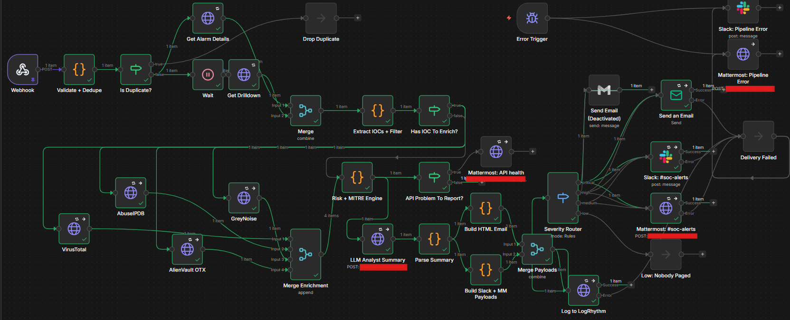
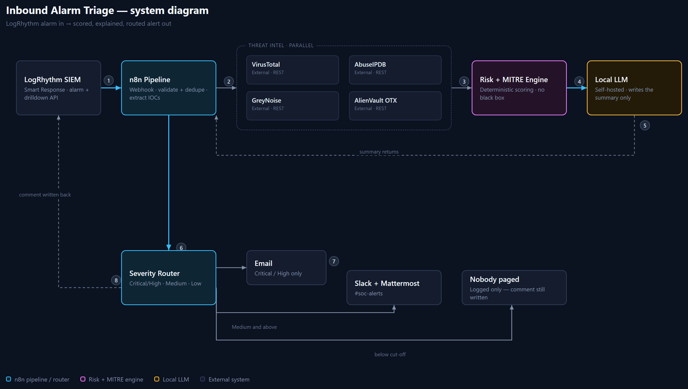
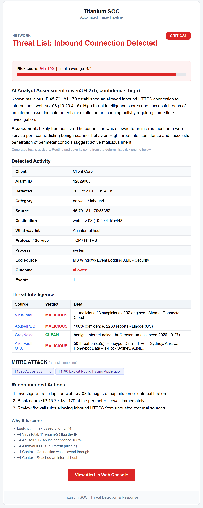
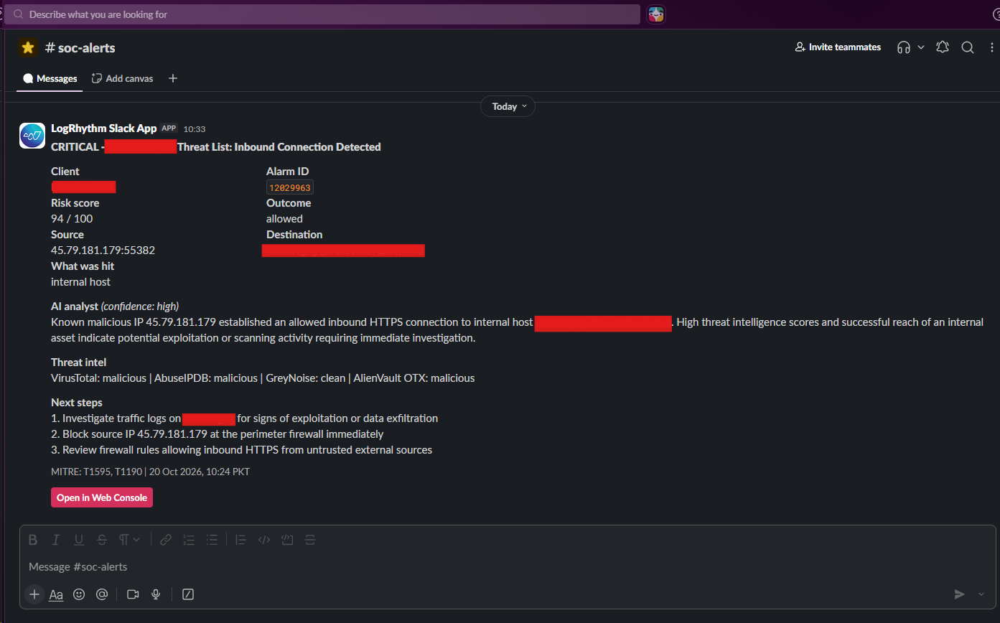

# LogRhythm n8n Automation Pipeline

An n8n workflow that takes a raw LogRhythm SIEM alarm and turns it into a scored, explained, routed alert, so an analyst isn't stuck pasting the same IP into four different threat-intel sites, forty times a shift.

## Why

Built for an MSSP. The junior analysts on the team were losing most of a shift to the repetitive half of triage - the tab-hopping between threat-intel sites, before they ever got to the part of the job that actually needed a person - threat hunting. This pipeline takes that half away and leaves them the rest.

## How it works

1. **LogRhythm fires a Smart Response** the moment an alarm triggers, just the alarm ID, nothing else leaves LogRhythm at this point. (SmartResponse files shared in SRP folder)
2. **The pipeline pulls the rest itself**: the alarm detail, the drilldown logs, and the attacker IP, straight from the raw log fields.
3. **Checks the IP against threat intel, in parallel** - VirusTotal, AbuseIPDB, GreyNoise, AlienVault OTX. A timeout or a quota limit on one never blocks the other three.
4. **Scores it with a deterministic risk engine** - LogRhythm's own risk score, plus a flat +4 for every intel source that flags the IP (one detection or ninety-nine, same +4), plus context points (was it allowed through? did it reach an internal host? a sensitive port?). No black box: every point is listed in the alert. A rough MITRE ATT&CK tag gets attached too, but it's informational only, it never feeds back into the score.
5. **A locally hosted LLM writes the summary** - it only ever writes prose, never severity or routing. Those are already decided by the time it's asked to write anything, so a bad or missing reply can't mis-route an alert; it just falls back to a plainer, rule-based sentence. Client data never leaves the environment.
6. **Routes by severity:**

   | Level | Goes to |
   |---|---|
   | Critical / High | Email + Slack + Mattermost |
   | Medium | Slack + Mattermost |
   | Low | Logged only, nobody paged |

   
7. **If anything in the pipeline itself breaks** - a failed delivery, every threat-intel source down at once - an error trigger catches it and reports to Slack and Mattermost on a separate channel from the normal alerts. A broken pipeline fails loud, not silent.

> **Heads up:** every number above, the score cutoffs, the +4 per source, the routing thresholds — is a demo default. Tune it for your own environment before trusting it in production.

## The companion workflow

A second, smaller workflow closes the loop: every alert posted to Mattermost gets auto-reacted with ✅ and ❌.

An analyst taps one, the workflow looks up who reacted, and closes the LogRhythm alarm with a comment naming them and the verdict - legitimate or false positive. No more manually closing alarms you already know are fine, and over time the pattern of ✅ vs ❌ on a given alarm type says something about which rules are mostly noise.

## Setup

1. Import `workflow.json` into n8n. 
2. To go live: create credentials for LogRhythm (Header Auth, `Authorization: Bearer ...`), VirusTotal (`x-apikey`), AbuseIPDB (`Key`), AlienVault OTX (`X-OTX-API-KEY`), GreyNoise (`key`, optional), Slack (bot token with `chat:write`), and SMTP for the email node - each node's notes say which it needs.
3. Replace the example hosts and the Mattermost webhooks with your own.
4. At the top of the **Risk + MITRE Engine** node: score cut-offs, points per threat-intel source, console link, logo, and the LLM model/endpoint.

### Having issues?
Feel free to reach out at `work.haroonabbasi@gmail.com`

## Examples

A real alert this pipeline produced (client name, hostname and internal IP swapped for placeholders, everything else real):

The same alert in Slack:

